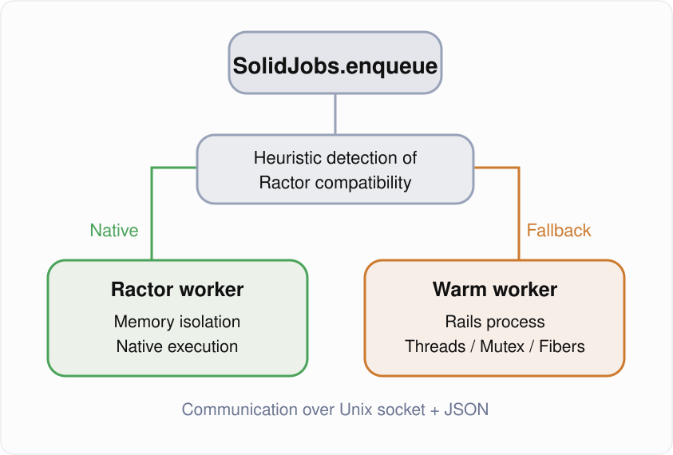

# SolidJobs

[](https://github.com/nicolasva/solid-jobs/actions/workflows/ci.yml)
[](https://rubygems.org/gems/solid-jobs)
[](https://rubygems.org/gems/solid-jobs)
[](https://www.rubydoc.info/gems/solid-jobs)

SolidJobs is a Ractor-oriented Redis task runner for Ruby. It provides its own
task API, Redis envelope, keyspace, interceptor model, failure policy, and
inspection API.

SolidJobs is **not compatible with Sidekiq**. It does not read Sidekiq queues,
does not write Sidekiq payloads, and does not expose Sidekiq's job API. Existing
applications and queued work must be migrated explicitly.

## SolidTrace observability

SolidJobs and SolidTrace have separate, complementary roles:

- **SolidJobs** is the job runner. It enqueues and executes background tasks,
  manages channels, retries, recovery, and worker Ractors.
- **SolidTrace** is the observability dashboard. It consumes structured
  lifecycle and operational telemetry emitted by SolidJobs and presents a
  read-only view of job activity and system health.

With SolidTrace, operators can inspect recent job executions and their
observed lifecycle, monitor queues and worker Ractors, and review process
resource usage, Redis health, telemetry freshness, and gaps that require
resynchronization. SolidTrace does not enqueue, execute, retry, or control
SolidJobs tasks; SolidJobs remains responsible for processing them. The
dashboard is a separate Sinatra/Rack component that can be mounted in a Rails
application, with host authentication and access protection supplied by that
application.

SolidTrace uses structured telemetry rather than job arguments or business
payloads. Its trace views show retained lifecycle events and calculable
durations, and identify missing or unavailable information instead of
guessing. See the [SolidTrace project](https://github.com/nicolasva/SolidTrace)
for more information.

### SolidTrace dashboard


For access to SolidTrace, contact me at [nicolas.vandenbogaerde@gmail.com](mailto:nicolas.vandenbogaerde@gmail.com).

## Installation

```ruby
gem "solid-jobs"
```

Then run `bundle install`.

## Defining and submitting tasks

```ruby
class RecalculateAccount
  include SolidJobs::Task

  task_options channel: "critical", max_failures: 10

  def execute_task(account_id)
    Account.find(account_id).recalculate!
  end
end

RecalculateAccount.enqueue(42)
RecalculateAccount.enqueue_after(30, 42)
RecalculateAccount.schedule_at(Time.now + 300, 42)
RecalculateAccount.enqueue_many([[42], [43], [44]])
```

The persisted envelope is specific to SolidJobs:

```json
{
  "id": "7ec33ed5-1b77-4bde-8960-bd77231f10ef",
  "task": "RecalculateAccount",
  "arguments": [42],
  "channel": "critical",
  "max_failures": 10,
  "created_ms": 1790981000000,
  "queued_ms": 1790981000001
}
```

All internal Redis keys use the `solid_jobs:` namespace. Ready work is stored
under `solid_jobs:channel:<name>`; planned, retrying, discarded, node, claim,
attempt, and metric data use separate namespaced keys.

Run executors:

```sh
bundle exec solid-jobs --require ./config/environment \
  --concurrency 8 --channel critical,3 --channel default
```

## Configuration

```ruby
SolidJobs.configure do |config|
  config.channels = [["critical", 3], "default"]
  config.channel_order = :weighted
  config.concurrency = 8
  config.shutdown_timeout = 25
  config.default_task_options = {
    channel: "default",
    max_failures: 25,
  }
end
```

`channel_order` accepts `:weighted` for bounded weighted round-robin,
`:priority` for declaration-order priority, and `:shuffle` for random
selection from the weighted channel list.

## Interceptors

Publication and execution use SolidJobs interceptors. An interceptor implements
`around(context)` and yields to continue:

```ruby
class TraceExecution
  def around(context)
    Telemetry.start(context.envelope.fetch("id"))
    yield
  ensure
    Telemetry.finish
  end
end

SolidJobs.configure do |config|
  config.execute_interceptors.use(TraceExecution)
end
```

Publication interceptors receive `SolidJobs::Publisher::Publication`; execution
interceptors receive `SolidJobs::Executor::Execution`.

## Failure handling

Tasks default to 25 failures. A task can customize the delay or final action:

```ruby
class ImportCatalog
  include SolidJobs::Task

  task_options max_failures: 8, retry_within: 3_600

  retry_delay do |failure_count, error, envelope|
    :drop if error.is_a?(InvalidCatalog)
  end

  after_final_failure do |envelope, error|
    Alerts.catalog_import_failed(envelope.fetch("id"), error)
  end
end
```

`retry_delay` may return a delay in seconds, `:drop`, or `:archive`. Without an
override, SolidJobs uses capped exponential backoff with equal jitter.

## Delivery semantics

SolidJobs provides **at-least-once** delivery. An executor atomically claims a
task before execution and completes the claim only after `execute_task` returns.
Graceful shutdown requeues unfinished tasks. Claims owned by a crashed node are
recovered into their original channels.

A process can still crash after an application side effect and before claim
completion. The recovered task then runs again. Tasks must be idempotent or use
application-level deduplication when duplicate effects are unsafe.

See [docs/reliability.md](docs/reliability.md) for the state machine, claim
fencing, recovery rules, and Ruby Ractor caveats.

## SolidEngine backend (SolidRedis or SolidEngine)

SolidJobs is the job API; the storage and execution engine sits behind a
backend adapter. Two adapters ship with the gem and your tasks do not change:

```
Application → SolidJobs → Backend adapter ─┬─ Backends::Redis       → SolidRedis → Redis
                                           └─ Backends::SolidEngine → Rust server (Unix socket / TCP)
```

```ruby
SolidJobs.configure do |config|
  config.backend = :redis                    # default for every channel

  config.backends = {
    redis:  {adapter: :solid_redis, url: "redis://localhost:6379"},
    engine: {adapter: :solid_engine, url: "unix:///var/run/solidengine.sock"},
    # TCP also works: "tcp://127.0.0.1:7777"
  }

  # Per-channel routing: run both engines side by side and migrate gradually.
  config.channel_backends = {"critical" => :redis, "default" => :engine, "bulk" => :engine}
  config.channels = %w[critical default bulk]
end
```

Setting only `config.backend = :solid_engine` and `config.url = "unix://..."`
routes every channel to SolidEngine. Without these options nothing changes:
the Redis path is the unchanged default.

```ruby
class SendEmail
  include SolidJobs::Task
  task_options channel: "critical"
  def execute_task(user_id) = # ...
end
SendEmail.enqueue(42)   # Redis or SolidEngine, decided by the channel
```

`Conductor` starts Ractor processors for channels served by Redis and, in
the same process, `concurrency` workers per non-Redis backend (one connection
each, lease keep-alive while a task runs). If every channel is
routed to SolidEngine, no Ractor, heartbeat or Redis scheduler is started and
Redis is not required.

### Backend contract

`SolidJobs::Backends::Base` defines `enqueue`, `schedule(at:)`, `claim(channel)`,
`ack(claim)`, `retry_job(claim, delay:)`, `fail_job`, `get_job`, `recover`,
`capabilities` and `supports?`. A *claim* is the object returned by `claim`; it
carries the reservation and fencing tokens, so `ack` and `retry_job` take the
claim rather than a bare job id. Delivery is at-least-once on both adapters.

Guarantees are not hidden. Operations a backend cannot honor raise
`SolidJobs::Backends::NotSupported`; check `backend.supports?(:capability)`:

| Capability | SolidRedis | SolidEngine |
|---|---|---|
| At-least-once, claim/ack, retries, scheduling | yes | yes |
| Crash recovery | yes (node heartbeat scan) | yes (server-side lease expiry) |
| Deduplication by job id | no | yes (`push` of an existing id is idempotent) |
| Fencing tokens, lease extension | claim-token check only | yes (stale `ack`/`nack` is rejected) |
| `get_job` by id, `cancel` | no | yes |
| Durability | Redis persistence settings | `memory`, `balanced` or `strict` (server config) |

Job ids must be UUIDs on SolidEngine (the default). Channel names map to
engine channel ids by CRC32 unless `channel_ids:` is set in the backend spec:
pin the mapping in production. Retry/discard follows the task options
(`max_failures`, `retry_within`, `retry_delay`, `after_final_failure`);
`discarded` archives stay Redis-only, SolidEngine keeps dead jobs itself.

### Switching a channel

Changing a channel's backend **does not migrate jobs already queued** in the
old engine. Drain the old queue first (keep a worker on it until empty), then
switch producers, then workers. To roll back, keep a worker on the SolidEngine
channel until `stats` shows it is empty. Jobs must be idempotent in both
directions.

### Execution mode (independent of the backend)

```ruby
SolidJobs.configure do |config|
  config.backend = :solid_engine
  config.execution_mode = :ractor   # default; or :thread
  config.concurrency = 4
end
```

- `:ractor` (default): each worker is a Ractor that builds **its own**
  SolidEngine client (own socket, no shared state, no central relay), so CPU
  tasks run in parallel exactly as with Redis.
- `:thread`: workers are threads of the main Ractor, bound by the GVL. Use it as
  an explicit fallback when a task depends on code that is not Ractor-compatible
  (non-shareable globals, unsupported native extensions, closures as callbacks).

Redis channels always use Ractor processors. The mode is never changed silently
by the backend choice.

### Limits of this release

The Python (`solid-jobs-py`) and Node.js (`solid-jobs-node`) packages contain
the SolidEngine client but not yet this routing layer. `Catalog`, `Observations`,
`Console` and `IntegrityCheck` still read Redis only.

### SolidEngine benchmark

Run `bundle exec rake comparison` in `benchmark_sidekiq_solid-jobs` with
`SOLID_ENGINE_BIN` pointing at `solid-engine-server`; the `process-*`
scenarios then add a `solid-jobs-engine` client (jobs through SolidEngine in
`memory` durability, matching Redis without persistence; Redis only holds the
benchmark counters). Results: see [Performance](#performance-solidjobs-vs-sidekiq)
and [SolidEngine A/B on CPU tasks](#solidengine-ab-on-cpu-tasks-process-cpu).

## Node control

```ruby
node = SolidJobs::Nodes.new.first
node.request_control(:pause)
node.request_control(:backtraces)
node.request_control(:shutdown)
```

Control requests are asynchronous and use the selected node's namespaced Redis
mailbox. Unknown actions raise `KeyError` without writing a request.

## Lab

```ruby
SolidJobs.testing!(:capture) do
  RecalculateAccount.enqueue(42)
  RecalculateAccount.captured
end

SolidJobs.testing!(:execute) do
  RecalculateAccount.enqueue(42)
end
```

Run the project suites:

```sh
bundle exec rake test
STRESS_JOBS=10000 bundle exec rake stress
SOLID_JOBS_TORTURE=1 STRESS_JOBS=100000 bundle exec rake torture
SOLID_JOBS_SOAK=1 SOLID_JOBS_SOAK_SECONDS=86400 bundle exec rake soak
```

## Migrating from Sidekiq

There is no transparent migration path because compatibility is intentionally
absent:

1. Replace `include Sidekiq::Job` with `include SolidJobs::Task`.
2. Replace `sidekiq_options` with `task_options`.
3. Replace `perform_async`, `perform_in`, and `perform_bulk` with `enqueue`,
   `enqueue_after`, and `enqueue_many`.
4. Replace middleware with SolidJobs interceptors.
5. Drain or export existing Sidekiq queues before switching. SolidJobs will not
   consume them.
6. Start SolidJobs with `--channel`; `--queue` is not accepted.

The Active Job adapter remains available as
`ActiveJob::QueueAdapters::SolidJobsAdapter`, but it writes only SolidJobs
envelopes and keys.

## Instrumentation

SolidJobs exposes an optional Ractor-local instrumenter and defaults to a
no-op. Any configured instrumenter must respond to `instrument(name, payload)`
and be Ractor-shareable before a conductor starts. Ordinary instrumentation
failures are logged when possible and never change publication, execution,
retry, acknowledgement, recovery, or shutdown behavior. Process-control
interruptions still propagate so shutdown can requeue in-flight work.

SolidJobs emits the v1 lifecycle events `job.enqueued`, `job.journaled`,
`job.reserved`, `job.started`, `job.completed`, `job.failed`,
`job.retry_scheduled`, `job.dead`, `job.acknowledged`, and `job.recovered`.
Ready jobs are not reservable until `job.enqueued` and `job.journaled` have
been emitted; an expiring Redis publication barrier preserves this order
without stranding work if a publisher exits.
They carry correlation identifiers and structured errors, but never task
arguments, business payloads, secrets, or textual logs. `node_id` is shared by
all Ractors in a conductor; `ractor_id` and `worker_id` are integer processor
identities. `reservation_id` is the reliable claim token.

The heartbeat Ractor also samples and emits `process.observed`, one
`ractor.observed` per logical processor, and one `redis.observed` per processor
every five seconds. Process observations are limited to process CPU time, RSS,
GC count/time, and total Ruby allocations. Sources are local Ruby/OS reads made
outside worker Ractors. A source that has never succeeded is `unavailable`; a
later failure preserves the last value as `stale` with its increasing age.
SolidJobs never estimates CPU, memory, GC, or allocations per Ractor.

Ractor observations expose only state, activity, integer
`ractor_id`/`worker_id`/`executor_id`, and current job IDs. Quiet workers report
`waiting`; shutdown reports `stopping` then `stopped` without inventing work.
Redis connection state comes from worker operations already being performed:
successful operations report `connected` and `SolidRedis::ConnectionError`
reports `disconnected`. No monitoring-only Redis command is added. Redis
latency, command, memory, and connection-count metrics remain explicitly
`unavailable` until a reliable source exists.

## Transparent Ractor-Safe Hybrid Execution Architecture

Ractors enforce a strict shared-nothing model. Referencing mutable global
state, legacy connection pools, or thread-based dependencies (**ActiveRecord**,
**ActionMailer**, or gems built on `Mutex`, `Thread` and `Fiber`) inside a
Ractor raises `ArgumentError: can't share mutable object`.

SolidJobs handles this with an **adaptive router** in `enqueue`: tasks that are
safe stay Ractor-native, and tasks that hold non-shareable state are
transparently forwarded to a persistent **warm worker** process. You do not
have to rewrite your gem stack.

### How it works



```text
Task.enqueue(*args)
   │
   ├─ requires_warm_pool? = false ─► Ractor-native path (Redis → worker Ractors)
   │
   └─ requires_warm_pool? = true ──► JSON payload ─► SolidJobsGenericExecutor
                                      ─► UNIXSocket ─► script/warm_worker.rb
                                         (booted Rails process, runs the task)
```

| Context | Path | Typical tasks |
|---|---|---|
| Pure / stateless | Ractor-native, runs on all cores | CPU work, stateless I/O |
| Holds a `Mutex`, `Thread`, `Fiber` or pool in class-level state | Warm worker over a Unix socket | Legacy gems, shared connection pools |

The warm worker boots your application once and stays resident, so a routed job
pays no per-job boot cost, only a local socket round trip. The latency has not
been benchmarked.

### How routing is decided

`requires_warm_pool?(arguments)` returns `true` only when **all** of these hold:

1. `defined?(Rails)` is truthy.
2. At least one argument is not `Ractor.shareable?`.
3. The task class holds, in a class-level instance variable, a `Mutex`,
   `Thread` or `Fiber`, or an object whose class name contains `Pool`.

Otherwise `enqueue` runs the normal Ractor-native path. When routed, the
arguments are converted to plain JSON data (deep-copied and frozen) and enqueued
as a `SolidJobsGenericExecutor` task, which forwards them over a Unix socket.

> Detection is heuristic and inspects only class-level instance variables. It
> does not detect constants such as `ActiveRecord::Base` referenced inside
> `execute_task`. Arguments must be JSON-serializable, and a task with
> shareable arguments always stays Ractor-native.

### Components

- `app/jobs/solid_jobs_generic_executor.rb` — `SolidJobsGenericExecutor`
  connects to `/tmp/solid_jobs_rails_<worker_id>.sock`, sends
  `{"target_class": ..., "arguments": [...]}` as one JSON line, and returns the
  result or raises `SolidJobsGenericExecutor::RemoteError`. The worker is chosen
  as `crc32(task name) % SOLID_JOBS_WARM_WORKERS` (default `1`, stable across processes). Require this file
  explicitly (it is loaded automatically on first routing).
- `script/warm_worker.rb` — a standalone process, run outside any Ractor, that
  loads `config/environment.rb` from its working directory once, listens on the
  socket, resolves the class with `Object.const_get`, runs `execute_task` (or
  `perform`), and replies with `{"status":"ok","result":...}` or
  `{"status":"error","error_class":...,"message":...}`. Requests are handled one
  at a time per worker. The socket is created with mode `0600` and removed on
  `INT`/`TERM`.

### Running warm workers

Warm workers are **not** spawned by `solid-jobs`; start and supervise them
yourself (systemd, foreman, Procfile, ...), one per worker id, from the Rails
root:

```bash
SOLID_JOBS_WARM_WORKERS=2 bundle exec ruby script/warm_worker.rb 0 &
SOLID_JOBS_WARM_WORKERS=2 bundle exec ruby script/warm_worker.rb 1 &
bundle exec solid-jobs --require ./config/environment --concurrency 8 --channel critical
```

The worker count used by the runner must match the number of workers started.
The boot cost is paid once per worker; the process then stays warm. Memory is
reclaimed only when a worker is restarted, so supervise and recycle them as you
would any long-lived Rails process.

### Usage

Include the task module as usual; the only requirement is that the class-level
state that makes the task unsafe is visible to the detector, and that your
arguments are JSON-serializable:

```ruby
class SyncAccounts
  include SolidJobs::Task
  @lock = Mutex.new # class-level non-shareable state => warm worker routing

  def execute_task(account_ids)
    Account.where(id: account_ids).find_each(&:sync!)
  end
end

SyncAccounts.enqueue([1, 2, 3]) # routed to the warm worker
```

Tests live in `test/warm_pool_test.rb` and spawn a real worker process.

### Hybrid architecture benchmark: Ractor vs Unix-socket IPC

Run with `bundle exec rake hybrid` in `benchmark_sidekiq_solid-jobs`
(Ruby 4.0.7, 4 Conductor Ractors, 4 warm workers, 10,000 mutable tasks per
mode, all routed to the warm pool). Each latency series is stored as its own
microsecond array and histogram, in JSON and Markdown under `results/`.

- **Ractor pure:** time inside a Conductor Ractor between the `job.reserved`
  event (payload returned by Redis) and `job.started` (just before the task
  runs). SolidJobs reserves with an atomic Lua `RPOP`, not `BLPOP`, so this is
  the closest equivalent.
- **IPC roundtrip:** `UNIXSocket` open → status line read, reported by the
  `warm_pool.roundtrip` instrumentation event of `SolidJobsGenericExecutor`.
- `transport` uses zero-work warm tasks to isolate the pure socket cost;
  `sustained` paces the 10,000 tasks linearly over 30 s; `burst` enqueues them
  at once. In `sustained` and `burst`, each warm task sleeps 5 ms to simulate
  service time, so their IPC roundtrip is dominated by that work (macOS timer
  granularity makes it ≈6.4 ms).

| Mode | Series | p50 (µs) | p95 (µs) | p99 (µs) |
|---|---|---:|---:|---:|
| Transport | Ractor pure | 9 | 21 | 39 |
| Transport | IPC roundtrip (no work) | 43 | 77 | 192 |
| Sustained 30 s (≈333 jobs/s) | Ractor pure | 25 | 51 | 119 |
| Sustained 30 s (≈333 jobs/s) | IPC roundtrip (5 ms work) | 6,355 | 11,713 | 12,680 |
| Burst | Ractor pure | 23 | 58 | 249 |
| Burst | IPC roundtrip (5 ms work) | 6,426 | 12,522 | 13,183 |

All 30,000 tasks completed with zero failures and **zero warm pool exhaustion
events**: the 4 Conductor Ractors never have more requests in flight than there
are warm workers. The pure socket overhead is tens of microseconds (p50 43 µs,
p99 192 µs); the rest of the IPC latency is the task's own work in the warm
worker.

**Saturation (oversubscribed pool).** With 8 Ractors on a single warm worker, a
30 ms timeout and 1,000 burst tasks, the pool is exhausted: 432 timeouts and 563
refused connections (the worker's Unix socket listen backlog is full), only 5
tasks completed on the first attempt, and the rest failed and went through
SolidJobs retries. Exhaustion is counted as `timeout` + `refused` + `ok`
roundtrips above `HYBRID_EXHAUSTION_MS`. Size the number of warm workers at
least equal to the Conductor concurrency, and set `SOLID_JOBS_WARM_TIMEOUT`
(default 30 s) accordingly. A timed-out request is not cancelled in the worker,
so make routed tasks idempotent.

*Environment: Ruby 4.0.7 (arm64-darwin27); SolidJobs 0.5.0; local loopback,
synthetic work, single run per mode.*

## Commercial licensing & observability

`SolidJobs` is open source under the **LGPL-3.0-or-later** license.

Running multi-core clusters blind in staging or production makes monitoring
hard. For visual insight into Ractor memory allocation, CPU thresholds, and live
queue states, pair this gem with **SolidTrace** (commercial licenses available
from $50 to $200 / month).

For commercial keys, custom architecture audits, or enterprise support, contact
**licensing@solidtrace.io**.

## Performance: SolidJobs vs Sidekiq

SolidJobs uses Ruby Ractors for parallel execution across real CPU cores, while
Sidekiq uses threads within a single Ruby process subject to the Global VM
Lock (GVL).

The benchmark suite (`benchmark_sidekiq_solid-jobs`) measures throughput and
resource usage under identical workloads against an isolated Redis server.

### CPU Workload (`process-cpu`)

Sidekiq remains capped by Ruby's GVL near 1 core (~100% CPU), whereas SolidJobs
scales linearly across cores:

| Concurrency | Sidekiq (jobs/s) | SolidJobs (jobs/s) | SolidJobs Scaling | Sidekiq CPU | SolidJobs CPU |
|---:|---:|---:|---:|---:|---:|
| 1 | 290 | 282 | 100.0% | 95.9% | 94.6% |
| 2 | 299 | 556 | 98.5% | 100.3% | 190.7% |
| 4 | 303 | 1,094 | 96.9% | 100.3% | 378.2% |
| 8 | 302 | **2,170** | **96.2%** | 100.1% | **761.0%** |

*At 8 concurrency, SolidJobs delivers **7.2× the throughput** of Sidekiq on pure CPU workloads.
This table comes from the Ruby 4.x campaign (see the environment line at the end
of this section); it predates the A/B campaign below and is not directly comparable with it.*

### SolidEngine A/B on CPU tasks (`process-cpu`)

Same tasks and repetitions for every client; median of 6 runs (min–max), jobs/s.
Sidekiq is one process with N threads. Machine: 12 cores (8 performance).

**Ruby 4.0.7**

| Concurrency | Sidekiq (threads) | SolidJobs + Redis (Ractors) | SolidJobs + SolidEngine (Ractors) | SolidJobs + SolidEngine (threads) |
|---:|---:|---:|---:|---:|
| 1 | 286 (281–290) | 268 (263–272) | 289 (281–293) | 285 (281–291) |
| 2 | 295 (289–299) | 511 (501–517) | **564** (546–573) | 293 (293–296) |
| 4 | 298 (294–299) | 940 (936–949) | **1,100** (1,094–1,106) | 295 (292–296) |
| 8 | 297 (290–299) | 1,646 (1,593–1,672) | **2,031** (1,959–2,122) | 288 (285–296) |

Ruby-worker CPU-seconds per 1,000 jobs: 3.4–3.6 for every client at every concurrency.

**Ruby 3.4.4**

| Concurrency | Sidekiq (threads) | SolidJobs + Redis (Ractors) | SolidJobs + SolidEngine (Ractors) | SolidJobs + SolidEngine (threads) |
|---:|---:|---:|---:|---:|
| 1 | 202 (200–207) | 196 (192–199) | 209 (196–210) | 206 (205–208) |
| 2 | 211 (209–213) | 296 (277–319) | **327** (310–337) | 205 (202–209) |
| 4 | 210 (204–213) | **464** (281–497) | 401 (376–446) | 208 (203–209) |
| 8 | 214 (211–216) | **313** (290–317) | 303 (299–329) | 209 (207–211) |

CPU-seconds per 1,000 jobs on Ruby 3.4.4: 4.7–4.8 at concurrency 1; at concurrency 8
Redis Ractors 24.3, Engine Ractors 25.8, Engine threads 4.8, Sidekiq 4.7.

CPU covers the Ruby worker process only, not Redis or the SolidEngine server.

Three separate conclusions:

1. **Execution model** (same SolidEngine backend): Ractors reach 2,031 jobs/s at
   concurrency 8 on Ruby 4.0.7 against 288 for threads (about 7×). The earlier
   plateau was the GVL, not the server.
2. **Backend** (both in Ractors): on Ruby 4.0.7 SolidEngine leads Redis at every
   concurrency with non-overlapping ranges (+10% at 2, +17% at 4, +23% at 8). On
   Ruby 3.4.4 the two are comparable and ranges overlap.
3. **SolidJobs vs Sidekiq:** on Ruby 4.0.7, 5.5× (Redis) and 6.8× (SolidEngine) at
   concurrency 8 with flat CPU per job. On Ruby 3.4.4, 1.5–2.2× at concurrency 2–4,
   then throughput drops and CPU per job rises sharply at 8 for both backends: the
   Ractor coordination cost is a Ruby 3.4 runtime issue, so Ruby 4 is recommended.

Not covered: several Sidekiq processes at equal CPU, more than 8 performance cores.
Reports: `benchmark_sidekiq_solid-jobs/results/ruby-{3.4.4,4.0.7}-process-cpu-ab.md`.

### Mixed Workload (`process-mixed` — CPU + I/O)

| Concurrency | Sidekiq (jobs/s) | SolidJobs (jobs/s) | SolidJobs Scaling |
|---:|---:|---:|---:|
| 1 | 178 | 195 | 100.0% |
| 2 | 402 | 419 | 107.4% |
| 4 | 567 | 822 | 105.4% |
| 8 | 578 | **1,816** | **116.3%** |

*At 8 concurrency, SolidJobs delivers **3.1× the throughput** of Sidekiq on mixed workloads.*

### I/O Workload (`process-io`)

| Concurrency | Sidekiq (jobs/s) | SolidJobs (jobs/s) | SolidJobs Allocations/job |
|---:|---:|---:|---:|
| 1 | 151 | **158** | 58 |
| 2 | 302 | **311** | 54 |
| 4 | 593 | **604** | 50 |
| 8 | 1,121 | **1,133** | 52 |

### Stress test: concurrency 4, 8 and 16

Run with `bundle exec rake stress` (5,000 pre-seeded jobs per case, medians of
3 runs; `STRESS_CONCURRENCY`, `STRESS_REPETITIONS` and `STRESS_JOBS` override
the defaults). It writes a Markdown report and a CSV for plotting curves.

| Workload | Concurrency | Sidekiq (jobs/s) | SolidJobs (jobs/s) | Ratio | Sidekiq CPU | SolidJobs CPU |
|---|---:|---:|---:|---:|---:|---:|
| `process-cpu` | 4 | 295 | 1,021 | 3.5× | 100% | 358% |
| `process-cpu` | 8 | 288 | 1,916 | 6.7× | 100% | 683% |
| `process-cpu` | 16 | 293 | 2,117 | 7.2× | 100% | 875% |
| `process-mixed` | 4 | 557 | 792 | 1.4× | 99% | 144% |
| `process-mixed` | 8 | 567 | 1,656 | 2.9× | 101% | 305% |
| `process-mixed` | 16 | 568 | 3,073 | 5.4× | 101% | 590% |
| `process-io` | 4 | 595 | 574 | 0.96× | 21% | 28% |
| `process-io` | 8 | 1,177 | 1,053 | 0.89× | 31% | 43% |
| `process-io` | 16 | 2,295 | 1,932 | 0.84× | 48% | 75% |

- Sidekiq stays flat near one core on CPU and mixed work at every level, while
  SolidJobs keeps scaling; CPU gains flatten past 8 because the machine runs out
  of cores.
- On pure I/O (sleep) work, Sidekiq's threads are slightly faster at these
  levels and use less CPU. SolidJobs is not faster on I/O-bound jobs.
- Latencies in the report measure the drain of the pre-seeded backlog, not
  steady-state latency. Per-job execution p99 stayed under 10 ms for both.
- Zero errors in all 54 measurements.

*Environment: Ruby 4.0.7 (arm64-darwin27); Sidekiq 8.1.7; SolidJobs 0.5.0.*

### Client Enqueue Throughput

| Concurrency | Sidekiq Enqueue (jobs/s) | SolidJobs Enqueue (jobs/s) | Sidekiq Bulk (jobs/s) | SolidJobs Bulk (jobs/s) |
|---:|---:|---:|---:|---:|
| 1 | 22,497 | 24,125 | 249,694 | 204,206 |
| 2 | 24,691 | 43,201 | 286,079 | 354,652 |
| 4 | 24,137 | 66,750 | 291,407 | 617,298 |
| 8 | 23,462 | **90,956** | 285,176 | **852,909** |

Compared with SolidJobs 0.4.0 on the same benchmark matrix, individual
enqueue throughput improved by 2.2–4.3%. Bulk throughput at 8 concurrency
improved by 3.5%. CPU scaling efficiency at 8 Ractors improved from 94.0% to
96.2%.

### Memory & Allocations

- **Peak RSS:** Comparable processing footprint at 8 concurrency (42.5 MiB for
  SolidJobs and 41.9 MiB for Sidekiq on CPU tasks).
- **Allocations:** SolidJobs produces fewer object allocations per task (48 vs
  108 allocations/job on CPU tasks, 41 vs 60 on individual enqueue), reducing
  GC pressure. CPU-task allocations fell by 36% from SolidJobs 0.4.0.

*Environment: Ruby 4.0.1 (arm64-darwin25); Sidekiq 8.1.7; SolidJobs 0.4.1.
Fresh process per measurement; medians of six runs; zero benchmark errors.*
